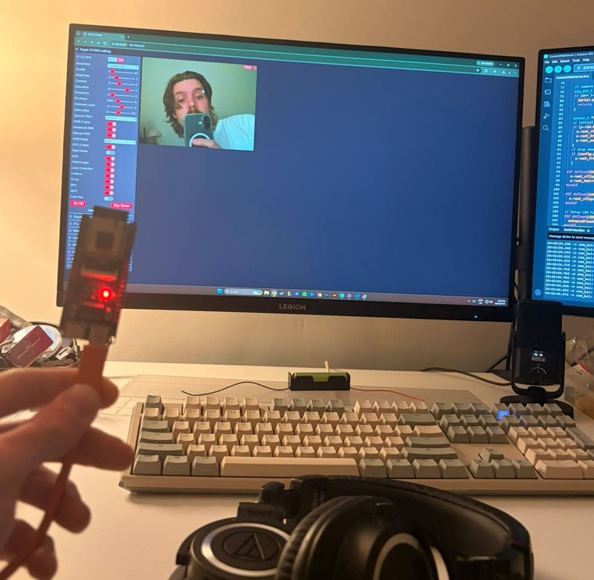
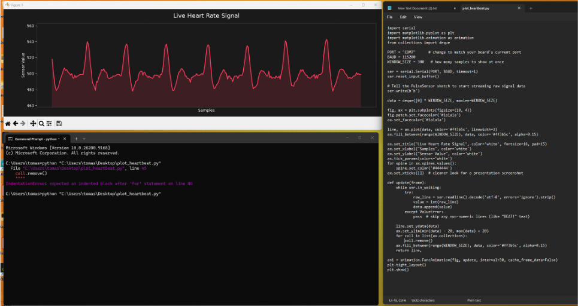
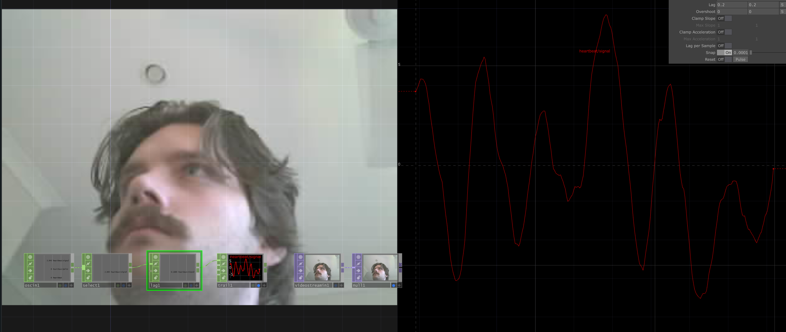
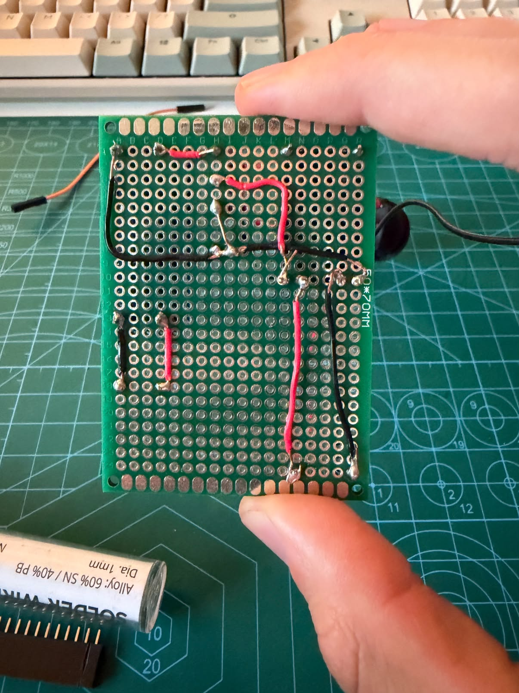
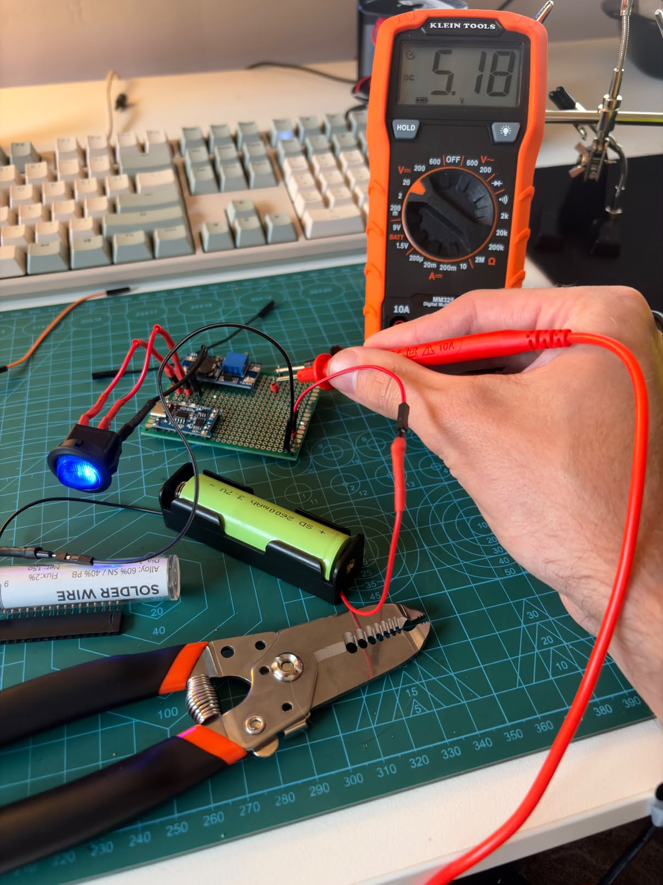
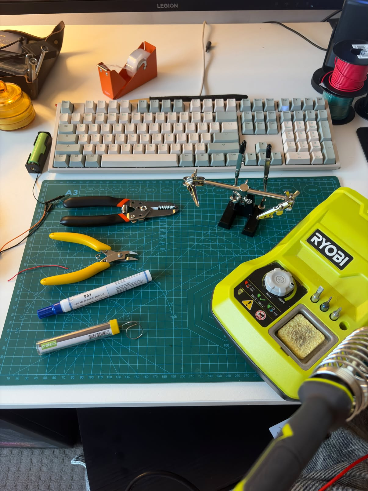

### DES222 Task 2 and 3 Process Journal
# This process journal will document the stages of ideation to creation for task 2/3's responsive tech design. The format and tone will resemble closer to a personal journal as opposed to a strict research journal, but will provide the necessary information and plans to recreate this project in the future if need be.

---
# Links
- [Code Used](CodeIndex.md)
-
---

### Narcissus

---
## The Big Idea
This project aims to respond visually to the users heart rate via a distortion effect applied to a live camera feed.
---

## Entry 1 06/09/26
The actual creation of this process journal was about a week ago, however, I have only started creating entries now that I have an overall plan for this project. After contemplating the overall difficulty of my project idea I decided it would be possible to attempt my ideal project outcome (standalone camera and heart rate monitor device sending data to a computer screen with printing capabilities). After researching which different microcontrollers and devboards would be suitable for my task, I settled on a ESP32-SC-CAM devkit that included a OV3660 camera. At this stage I have tested the device and the camera works great! I tested it by using a pre-made "example" in the Arduino IDE library specifically for this sort of project.

---

---

## Entry 2 08/09/26
This entry is when I began creating my pitch presentation and started researching about similiar projects such as [Pulse Topology](https://design-milk.com/rafael-lozano-hemmer-takes-your-pulse/), [Pulse Room](https://www.lozano-hemmer.com/pulse_room.php) and [Reccurent Waiting](https://www.lozano-hemmer.com/recurrent_waiting.php). after reviewing these projects I changed the name of my project to what it is currently called (it was originally called pulse). All three of these projects are created by Rafael Lozano-Hemmer who I now realise is basically the godfather of interactive heart beat art displays. Rafael's work in the "Pulse" series sees lightbulbs either pulsing or flickering in some way to the participants heart rate. when the next participant adds their heart beat to the display, it pushes the previous pulse along until eventually, after enough new participants join, the pulse is gone, representing the inevitability of death in a gentle way. the "Reccurent Waiting" piece was more dramatic in its messaging. "Reccurent Waiting" is an interactive mirror installation that explores the tension between self-perception, loss of control, and digital puppetry. The mirror replicates the viewers image but the reflection blinks and moves erratically following a timed sequence that transmits Lucky's monologue from "Waiting for Godot" in morse code. I chose to mention this work of his as it closeley relates to a "distortion" of some sort on a live reflection of the viewer, something that I'm planning on achieving. the themes he is representing in that piece is also quite similiar to that of my own for my project.

 I Also tested the heart rate monitor on the esp32 using a [library](https://docs.arduino.cc/libraries/pulsesensor-playground/) that I downloaded that included more examples. at this stage my goal was to make sure both devices could receive and send data to my computer and they are successful in doing so at this stage.

---

---

## Entry 3 10/09/26
I started this session by finalising my slideshow for the presentation, no script was created for it as I was planning on freestyling with just a few notes. hopefully it didnt backfire. This will be the final entry before the Task 2 Pitch is presented and the next entry/ies will process the physical creation of the project. for now, I will create a list below of products that I purchased for this project, and other items that I already had that im expecting to use. not all products listed will be used and future entries will narrow down the exact products for the final project. I havent tested my thermal printer for a while so I will need to make sure that still works how its meant to and try and configure some final code that prints images as simply as possible. I will add some photos of the printer in action below the list!

- ESP32 S3 CAM Development Board + OV3660 Camera
- 16mm Illuminated Green Momentary Push Button Switch – 4-Pin
- MT3608 Step Up Module
- 3.7V 2600mAh 18650 Cell Li-Ion Battery With Soldered Tabs – Lithium Ion
- TP4056 Type C 18650 Lithium Battery Charger + Protection
- Copper Prototype Perfboard - 7x9cm
- 170 Tie-points Mini Solderless Breadboard - Yellow
- Assorted m/m m/f f/f jumper wires
- Assorted LEDS
- Multimeter
- Soldering Iron
- Thermal Printer
- USB-C to USB-C Cable

---

## Entry 4 26/09/26
16 days since the last entry, and this is the first time I have worked on the narcissus project. recently I have used alot of touchdesigner for a different UNI assignemt and I have had the idea to create the distortion with that. first step though is getting the esp32 camera connecting to touchdesigner. It was alot simpler than I first thought! using a Video Stream In TOP I could use the same method that the CameraWebServer example used, and use my IP to directly stream video to a videostreamin TOP. my next step was to get the heart rate monitor sending its data to touchdesigner. I'm using OSC to send the heart rate monitor data wirelessly from the esp32 to TD. this was a simple way to send the data wirelessly and it was handy because TD has OSC integration built in via the OSC In chop that I will be using. this code was vibe coded using Claude. After a couple of hours of tinkering I finally got them both working and displaying data in TouchDesigner, i'll add an image below!

---

---

## Entry 5 08/10/2026
Another big jump from my last entry so I began by using Claude to tidy up/simplify my current code. at this stage all of the video distortion will be created in TouchDesigner, taking input from the HW-827. Speaking of, it looks like between now and the last time I worked on the project, I have fried or damaged the unit. I have two more on the way now from jaycar and I will be extra careful with these ones. on the bright side, the simplified code is working and I will add it to my process journal code page. I spent the rest of this session working on and learning how to power the whole unit.

---

## Entry 6 09/10/2026
Following yesterday, I began work on some sort of power supply. My plan was to use my lithium battery, TP4056 charger + protection, a LED rocker switch from jaycar, and the MT3608 step up module. I watched a few youtube videos and read a few reddit posts and couldnt really get a clear answer of how they all work together but I decided to give it an estimated guess with my knowledge learnt from DES221 and DES222. I created a diagram in Illustrator, which will be added below, and tested with a breadboard and multimeter. Thankfully it worked and I was able to draw the correct voltage from the battery, turn it on and off, and also increase or decrease the voltage using the step-up converter. To end this session, I spent the rest of the time soldering the components to a perfboard to try and make it closer to a "final" prototype. I was succesful after many hours of burning my fingers and inhaling solder fumes and I will add a picture of my completed board below. This was my first time soldering anything more than a few wires together so it may look a little dodgy, but I learned alot from the experience and thoroughly enjoyed it. in theory, this board should be able to power my camera and heart rate monitor at the same time. at this stage I havent researched how to integrate the printer, but that will come after all the prior components are working together and ironed out.

---

---

